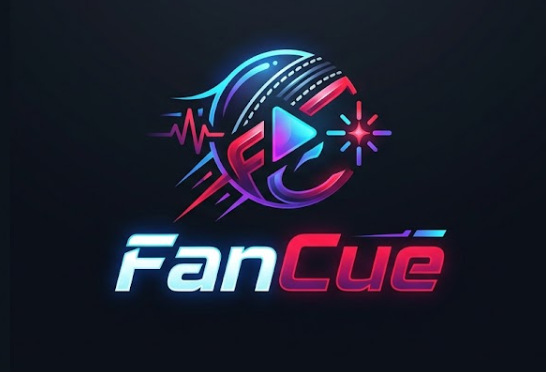
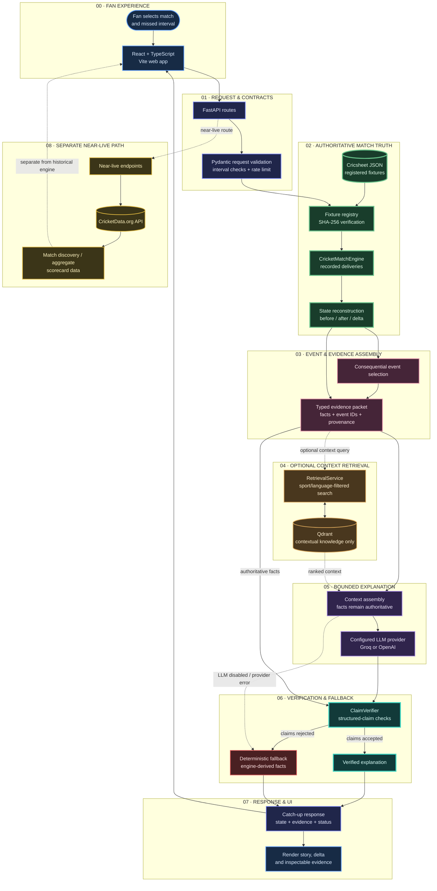

<div align="center">

  

  # FanCue — Evidence-Grounded Cricket Catch-Up

  
  
  
  
  
  <a href="https://github.com/praveen0767/FanCue/actions/workflows/ci.yml"></a>

  **Reconstruct → Compute → Trace Evidence → Explain → Verify → Re-engage**

  **FanCue turns a missed cricket interval into a concise, inspectable story.**

  [Product](#-what-fancue-does) · [Architecture](#-architecture) · [Verification](#-verified-engineering-evidence) · [Run locally](#-run-locally)

</div>

---

## 🏏 Build overview

Fans step away from a match and return to a scoreboard that tells them the current state—but not how the match reached it. FanCue focuses on that context gap.

A fan selects a supported historical cricket match and an interval. FanCue reconstructs the score state from recorded deliveries, computes the interval delta deterministically, selects consequential events, and returns an explanation whose factual claims are checked against the evidence packet.

> **Core principle:** The match engine owns the facts. AI may explain them, but cannot author the score.

### What the current implementation includes

- ✅ Historical cricket replay backed by two registered Cricsheet JSON fixtures.
- ✅ Deterministic score-state reconstruction and interval deltas.
- ✅ Key-event selection, evidence identifiers, and fixture provenance.
- ✅ Structured catch-up response with generation and verification status.
- ✅ Configurable Groq/OpenAI-compatible generation path.
- ✅ Claim verification and deterministic fallback when generation is unavailable or rejected.
- ✅ Optional Qdrant retrieval for contextual knowledge—never for authoritative match scores. **It is disabled in the current Render configuration** (`FANCUE_RETRIEVAL_ENABLED=false`); production catch-up does not claim to use retrieval.
- ✅ Separate near-live match discovery and aggregate scorecard endpoints through CricketData.org.
- ✅ Regression tests, integration tests, and a GitHub Actions CI workflow.

**Scope boundary:** Historical replay is the main end-to-end product path. Near-live scorecards are a separate, provider-dependent data path; aggregate scorecards are not delivery-by-delivery history and must not be presented as a live ball-by-ball recap.

---

## 💡 What FanCue does

A catch-up request passes through this workflow:

```text
Choose a supported match
        ↓
Choose an innings + whole-over interval
        ↓
Load the registered Cricsheet fixture
        ↓
Reconstruct state before and after the interval
        ↓
Compute runs, wickets, legal balls, extras and state delta
        ↓
Select consequential events and attach evidence
        ↓
Build a typed evidence packet
        ↓
Optional contextual retrieval
        ↓
Generate a bounded explanation, when configured
        ↓
Verify claims against authoritative facts
        ↓
Verified explanation OR deterministic fallback
        ↓
Return the story, score delta, evidence and status
```

The user sees more than prose. The response includes the reconstructed match states, their delta, event/evidence data, and explicit explanation status so the UI can distinguish verified generation from deterministic fallback.

---

## 🏗️ Architecture

The architecture is deliberately layered. Each stage has a clear source of truth and a bounded responsibility.



> **Control-flow invariant:** Recorded deliveries → deterministic engine → evidence packet → bounded generation → claim verification → verified response or deterministic fallback.

<details>
<summary><strong>View the detailed request lifecycle</strong></summary>

```mermaid
sequenceDiagram
    actor Fan
    participant UI as React UI
    participant API as FastAPI
    participant Engine as CricketMatchEngine
    participant Context as Optional Qdrant retrieval
    participant LLM as Configured LLM
    participant Verify as ClaimVerifier

    Fan->>UI: Select fixture, innings and interval
    UI->>API: POST /catchup
    API->>Engine: Load fixture and validate boundaries
    Engine-->>API: State before/after, delta and event facts
    API->>API: Assemble evidence packet

    opt Retrieval enabled and available
        API->>Context: Request filtered contextual passages
        Context-->>API: Ranked passages with source metadata
    end

    opt LLM configured and available
        API->>LLM: Generate structured explanation from evidence
        LLM-->>API: Structured explanation draft
        API->>Verify: Check claims against facts and citations
        alt Verification passes
            Verify-->>API: Accept verified explanation
        else Verification rejects draft
            Verify-->>API: Reject draft
            API->>API: Build deterministic fallback
        end
    else LLM disabled or unavailable
        API->>API: Build deterministic fallback
    end

    API-->>UI: State, evidence, explanation and status
    UI-->>Fan: Read catch-up and inspect supporting events
```

</details>

### Runtime stages

| Stage | Component | Responsibility |
|---|---|---|
| **01 — Request** | FastAPI + Pydantic | Validate the request, match ID and interval boundary contract. |
| **02 — Match truth** | Fixture registry + `CricketMatchEngine` | Load supported data and compute authoritative match states. |
| **03 — Evidence** | Event selector + evidence builder | Select meaningful events and attach source event IDs and provenance. |
| **04 — Context** | `RetrievalService` + Qdrant (optional) | Retrieve background knowledge; never overwrite score or event facts. |
| **05 — Generation** | Configured Groq/OpenAI provider | Draft a structured explanation from the supplied evidence. |
| **06 — Verification** | `ClaimVerifier` | Check generated claims before returning them as verified. |
| **07 — Degradation** | Deterministic fallback | Return an engine-derived recap when generation is disabled, unavailable or rejected. |
| **08 — Presentation** | React + TypeScript | Display the story, score delta, status and inspectable evidence. |

---

## 🔒 Non-negotiable engineering invariants

### 1. Match facts have one source of truth

The deterministic engine reconstructs scores, wickets, legal balls, extras, overs and interval deltas from the recorded delivery ledger. The LLM and vector search do not calculate or override these numbers.

### 2. Context retrieval is not match-state storage

Qdrant is for contextual knowledge such as cricket rules and background information. Similarity ranking is not authoritative scorekeeping. Retrieval is optional and can be disabled in constrained deployments.

### 3. Generated claims are gated

A generated explanation is only returned as verified when it passes the structured claim-verification path. If generation is unavailable or the draft is rejected, the application can use a deterministic fallback based on engine output.

### 4. Historical and near-live data are separate

Cricsheet fixtures power historical interval reconstruction. CricketData.org powers separate match-discovery and aggregate-scorecard endpoints. The latter does not supply the full delivery history required by the historical engine.

### 5. Overs are not decimal numbers

The interval contract uses whole-over integer boundaries. Internally, `start_after_over` is exclusive, `end_after_over` is inclusive, and `-1` represents the start of an innings. Cricket notation such as `16.5` means 16 overs and 5 legal balls—not decimal 16.5 overs.

---

## 📦 Supported data & provenance

FanCue currently registers two historical Cricsheet JSON fixtures. Their expected SHA-256 values are checked by the fixture-loading path.

| Match ID | Fixture | Format | Source |
|---|---|---|---|
| `1529229` | India vs West Indies | ODI | [Cricsheet JSON](data/raw/1529229.json) |
| `1552779` | India vs Pakistan | T20 | [Cricsheet JSON](data/raw/1552779.json) |

The data provenance registry is in [`data/sources.yml`](data/sources.yml), and attribution requirements are documented in [`data/ATTRIBUTION.md`](data/ATTRIBUTION.md). The registered JSON fixtures are recorded under the Open Data Commons Attribution License (ODC-By v1.0); consult [Cricsheet’s current licensing guidance](https://cricsheet.org/licensing/) before redistributing data or making commercial use.

The application does not invent a match to fill a missing fixture. The fixture registry only advertises known, supported files.

---

## 🌐 API surface

| Method | Route | Purpose |
|---|---|---|
| `GET` | `/healthz` | Lightweight process liveness probe. |
| `GET` | `/readyz` | Operator diagnostic for fixture availability and configured retrieval/LLM mode. |
| `GET` | `/matches` | List supported historical fixtures. |
| `GET` | `/matches/{match_id}/intervals` | Return valid intervals derived from actual fixture data. |
| `POST` | `/catchup` | Reconstruct a historical interval and return evidence plus verified explanation or fallback. |
| `GET` | `/matches/near-live` | Discover near-live matches through CricketData.org. |
| `GET` | `/matches/near-live/{match_id}/scorecard` | Fetch a provider scorecard; this is not delivery-level replay. |

The current Render configuration uses Groq (`LLM_PROVIDER=groq`, `GROQ_MODEL=openai/gpt-oss-20b`) and sets `FANCUE_RETRIEVAL_ENABLED=false`. Qdrant retrieval remains optional and is used only in environments where it is explicitly enabled and tested. The catch-up response includes `state_before`, `state_after`, `state_delta`, an evidence packet, and an `explanation` object. Check `explanation.generation_mode`, `explanation.verification_status` and `explanation.fallback_reason` when interpreting a response.

For a public release review, a healthy `/healthz` response is not sufficient: follow [`docs/PUBLIC_DEMO_ACCEPTANCE.md`](docs/PUBLIC_DEMO_ACCEPTANCE.md) to check CORS, the actual browser journey, evidence references and cold/warm request latency.

---

## 🧪 Verified engineering evidence

### CI baseline

The merged hardening revision was validated by the repository’s GitHub Actions workflow:

| Check | Recorded result |
|---|---:|
| Backend test suite | **433 passed, 1 skipped** |
| Reported backend/ingestion statement coverage | **90%** |
| Frontend typecheck and production build | **Passed** |

- CI run: [FanCue CI — hardening commit](https://github.com/praveen0767/FanCue/actions/runs/38539786400)
- Tested merge commit: `41768516e458b9e2ebd892252cb2304629a53c0f`

These figures describe that recorded run, not a promise that every later commit or hosted deployment is healthy. Rerun the workflow after code changes.

### Curated retrieval evaluation

The retrieval report documents a small, fixed evaluation of **24 queries** against **67 indexed cricket-knowledge chunks** in the development collection.

| Metric | Recorded result |
|---|---:|
| HitRate@3 | 100.00% |
| MRR@5 | 0.9524 |
| Wrong-sport leakage | 0 |
| Wrong-language leakage | 0 |
| Average query latency | ~155 ms |

Source: [`docs/evaluation/retrieval-evaluation.md`](docs/evaluation/retrieval-evaluation.md).

**Interpretation boundary:** this is a curated retrieval benchmark, not a general-purpose benchmark, not an evaluation of every generated explanation, and not proof of public production latency. It does not establish fan retention, product-market fit or incremental benefit from AI.

### What this evidence does and does not prove

**Covered by repository tests and recorded evaluations**
- Deterministic engine, interval and response-contract behaviour.
- Evidence and claim-verification logic covered by the test suite.
- Fixture checksum checks for the two registered matches.
- Retrieval quality and sport/language isolation on the documented curated query set.
- Frontend typecheck and production build on the recorded CI revision.

**Not claimed**
- A complete live ball-by-ball feed or broadcast synchronisation.
- Production-scale latency, availability or horizontal scaling.
- A statistically significant improvement in fan engagement or retention.
- Independent validation of every explanation in the public deployment.
- Completed fan interviews or product-market fit.

---

## 🛡️ Reliability, safety and graceful degradation

- **Fixture integrity:** supported JSON fixtures are associated with known SHA-256 values and provenance records.
- **Typed boundaries:** request and response structures use Pydantic contracts.
- **Claim verification:** the generated draft passes through a rules-based verifier before being returned as verified prose.
- **Deterministic fallback:** the response can be built from computed state and events without requiring successful LLM generation.
- **Optional retrieval:** retrieval availability is not allowed to become the authority for match scores.
- **Credential boundary:** provider keys belong in backend environment variables or secret settings, never in frontend `VITE_*` variables or committed files.
- **CORS:** production should allow only the exact deployed frontend origin through `ALLOWED_ORIGINS`.
- **Safe errors:** unhandled API exceptions are returned with a generic client-facing message rather than internal tracebacks.
- **Rate limiting:** catch-up requests have an in-process limit; it is per application process and is not a global distributed quota.

### Failure semantics

| Failure | Expected behaviour |
|---|---|
| Fixture ID not supported | Return a structured not-found response; do not invent data. |
| Invalid or unavailable interval | Reject the request instead of guessing boundaries. |
| LLM key absent, provider error or rejected claim | Use deterministic fallback and expose generation/verification status. |
| Qdrant disabled or unavailable | Treat retrieval as optional; match facts remain engine-derived. |
| CricketData.org unavailable or quota exhausted | Near-live discovery/scorecards may fail; historical replay remains a separate path. |
| Hosted cold start or CORS misconfiguration | Verify against the deployed URL using the public acceptance runbook. |

---

## 🧰 Technology stack

### Backend
- Python 3.12
- FastAPI and Uvicorn
- Pydantic v2 typed request, evidence and response contracts
- Deterministic cricket match engine and fixture registry
- Structured claim verifier and deterministic fallback

### AI & retrieval
- Groq or OpenAI-compatible language-model provider (configured on the backend)
- Qdrant contextual vector retrieval (optional)
- FastEmbed-based ingestion/embedding components

### Frontend
- React
- TypeScript
- Vite

### Data & delivery
- Cricsheet historical JSON fixtures
- CricketData.org near-live discovery and scorecard integration
- Docker
- Render backend declaration (`render.yaml`)
- Vercel frontend deployment
- GitHub Actions, pytest and frontend production build

**Intentionally not represented as production dependencies:** PostgreSQL, Redis, football match ingestion, video playback and live delivery streaming are not part of the currently claimed FanCue catch-up path.

---

## 🚀 Run locally

### 1. Clone the repository

```bash
git clone https://github.com/praveen0767/FanCue.git
cd FanCue
```

### 2. Configure the backend

```bash
cp .env.example .env
python -m venv .venv
```

Activate the environment:

```bash
# Linux / macOS
source .venv/bin/activate

# Windows PowerShell
.venv\Scripts\Activate.ps1
```

Install the project and development dependencies:

```bash
python -m pip install --upgrade pip
pip install -e ".[dev]"
```

For a minimum local run without external retrieval, set `FANCUE_RETRIEVAL_ENABLED=false` in `.env`. Add a valid server-side `GROQ_API_KEY` or configure `LLM_PROVIDER=openai` with an appropriate `OPENAI_API_KEY` to enable live provider generation. Without a usable provider key, exercise the deterministic fallback path.

### 3. Start the API

```bash
uvicorn backend.app.main:app --reload --port 8000
```

The backend defaults to `http://localhost:8000`.

### 4. Start the frontend

Open a second terminal:

```bash
cd frontend
npm ci
npm run dev
```

The Vite development server normally runs at `http://localhost:5173`. The frontend API client defaults to `http://localhost:8000`; if you change the backend URL, define `VITE_API_BASE_URL` in the frontend environment.

Make sure the backend’s local `ALLOWED_ORIGINS` includes the actual Vite origin, typically `http://localhost:5173`.

### 5. Run the tests and production build

From the repository root:

```bash
pytest --cov=backend/app --cov=ingestion --cov-report=term-missing tests backend/tests
```

Build/typecheck the frontend:

```bash
cd frontend
npm ci
npm run build
```

### 6. Run public HTTP checks

With internet access, check the hosted service:

```bash
bash scripts/public-smoke-test.sh
```

The smoke script checks liveness, readiness, match-catalogue availability and CORS preflight. It intentionally does **not** claim to prove a full catch-up. Finish with the browser test described in [`docs/PUBLIC_DEMO_ACCEPTANCE.md`](docs/PUBLIC_DEMO_ACCEPTANCE.md).

---

## ☁️ Deployment

### Frontend — Vercel
- Set the project root to `frontend`.
- Set `VITE_API_BASE_URL` to the Render API base URL, without a trailing slash.
- This variable is baked into the frontend build and must not contain credentials.

### Backend — Render
- Deploy using the repository-root `render.yaml` and `backend/Dockerfile`.
- Set `FANCUE_ENV=production`.
- Set `ALLOWED_ORIGINS` to the exact Vercel production origin, for example `https://fan-cue.vercel.app` if that is the deployed origin.
- Set `GROQ_API_KEY` in Render’s secret/environment settings if using the configured Groq provider.
- Set `CRICKET_DATA_API_KEY` if the near-live endpoints are required.
- Retrieval is disabled by the checked-in Render configuration unless deliberately enabled and configured.

Do not commit `.env` files or API keys. Render’s free service may cold-start after inactivity; record first-request and warm-request latency instead of assuming the service is always warm.

Before submitting the public link, work through the [Public Demo Acceptance Runbook](docs/PUBLIC_DEMO_ACCEPTANCE.md).

---

## 📁 Repository structure

```text
FanCue/
├── Logo.png
├── backend/
│   └── app/
│       ├── adapters/
│       │   ├── cricket/
│       │   └── cricket_data/
│       ├── ai/
│       ├── api/
│       │   ├── catchup.py
│       │   ├── health.py
│       │   └── matches.py
│       ├── core/
│       │   ├── config.py
│       │   └── fixtures.py
│       ├── explanations/
│       ├── match_engine/
│       │   ├── cricket.py
│       │   ├── intervals.py
│       │   └── state.py
│       ├── orchestration/
│       │   ├── cricket_catchup.py
│       │   └── evidence_builder.py
│       ├── schemas/
│       └── verification/
│           └── claim_verifier.py
├── contracts/                   # JSON schemas and canonical contracts
├── data/
│   ├── raw/                     # Two supported Cricsheet JSON fixtures
│   ├── sources.yml              # Provenance registry
│   └── ATTRIBUTION.md
├── docs/
│   ├── architecture/
│   ├── decisions/               # Architecture decision records
│   ├── evaluation/
│   ├── plan/
│   ├── product/
│   ├── PUBLIC_DEMO_ACCEPTANCE.md
│   └── SUBMISSION_NOTE.md
├── frontend/
│   └── src/
│       ├── App.tsx
│       ├── App.css
│       └── lib/api.ts
├── ingestion/
│   └── knowledge/               # Context ingestion, embeddings and retrieval
├── scripts/
│   └── public-smoke-test.sh
├── tests/
│   ├── contracts/
│   ├── evaluation/
│   ├── ingestion/
│   ├── integration/
│   └── orchestration/
├── render.yaml
├── pyproject.toml
└── README.md
```

---

## 📚 Engineering documentation

- [Product vision](docs/product/vision.md)
- [MVP scope](docs/product/mvp-scope.md)
- [Cricket interval model](docs/product/interval-model.md)
- [System context](docs/architecture/system-context.md)
- [Data contracts](docs/architecture/data-contracts.md)
- [Architecture decisions](docs/decisions/)
- [Retrieval evaluation](docs/evaluation/retrieval-evaluation.md)
- [Data attribution](data/ATTRIBUTION.md)
- [Public demo acceptance runbook](docs/PUBLIC_DEMO_ACCEPTANCE.md)

---

<div align="center">

  ## FanCue

  **Catch the moment. Understand the game.**

  **Compute what happened. Show the evidence. Explain only what can be supported.**

</div>
