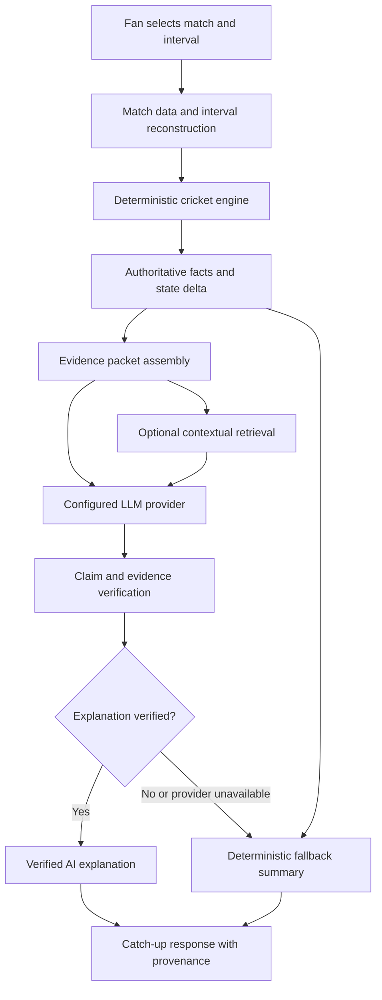

<div align="center">

# 🏏 FanCue

### Catch the moment. Understand the game.

**Evidence-grounded match catch-up for fans who missed the action.**

FanCue reconstructs a match interval from recorded sporting events, identifies what changed, and turns verified facts into a concise explanation—with a deterministic fallback when a language model is unavailable.

<br />

[](https://www.python.org/)
[](https://fastapi.tiangolo.com/)
[](https://react.dev/)
[](https://www.typescriptlang.org/)
[](https://vite.dev/)
[](https://qdrant.tech/)

<br />

**Product principle:** the model explains the match; it does not decide what happened.

</div>

---

## ✨ Why FanCue?

A scoreboard tells you the current state. It rarely tells the whole story.

You return to a cricket match after a call, a commute, or a long meeting. The score has moved. A key batter may be out. The required rate may have changed. You want to know more than *what is the score?* You want to know **what happened while I was away, which events mattered, and why?**

FanCue is designed to answer that question from inspectable match evidence instead of asking a language model to invent a recap from incomplete context.

## 🎬 The experience

1. **Choose a match** from the supported match catalogue.
2. **Select the interval** you missed—for example, a range of cricket overs.
3. **Reconstruct the match state** from available recorded events and score data.
4. **Identify meaningful changes**, such as runs, wickets, and interval scoring rate.
5. **Retrieve optional context** from a knowledge collection when configured.
6. **Generate an explanation** through the configured language-model provider when available.
7. **Verify claims** against authoritative facts before showing the AI explanation.
8. **Fall back gracefully** to a deterministic, fact-based summary when AI generation fails.

> 🛡️ A provider outage, exhausted quota, or malformed model response should not turn a catch-up request into a blank screen. The fallback is a first-class path—not a pretend AI response.

## 🧭 How the system works



### Separation of responsibilities

| Component | Responsibility | What it must **not** do |
|---|---|---|
| **Deterministic match engine** | Reconstructs interval facts and match-state changes from recorded data | Guess missing events or let an LLM overwrite the score |
| **Evidence packet** | Packages facts, state deltas, and relevant source references | Treat retrieved passages as official score data |
| **Qdrant retrieval** | Finds potentially relevant contextual knowledge when configured | Become the source of truth for a score or event |
| **LLM provider adapter** | Converts grounded evidence into readable structured prose | Introduce unsupported players, scores, wickets, or events |
| **Claim verifier** | Checks generated claims against the available authoritative facts and evidence | Assume fluent text is necessarily correct |
| **Deterministic fallback** | Produces a fact-based summary if AI generation cannot be trusted or completed | Label fallback text as AI-generated |
| **Frontend** | Presents the summary, status, and evidence to the fan | Hide whether the user received verified AI output or fallback |

## 📊 Quality signals and metrics

FanCue focuses on **correctness, traceability, retrieval relevance, and graceful degradation**—not just whether an LLM returns fluent text.

### Reported evaluation signals

| Signal | Reported result | How to interpret it |
|---|---:|---|
| Curated knowledge retrieval benchmark | **HitRate@3 = 1.00** | For the curated evaluation queries, at least one relevant result was found within the top three retrieved items. This is a dataset-specific result, not a guarantee for every query. |
| Backend automated test suite | **281 passed, 0 failed** | Most recently reported local run. Re-run tests on the exact commit being submitted; this is not a claim that the public CI workflow is green. |
| Frontend TypeScript + production build | **Reported passing** | The local `tsc -b && vite build` run was reported as successful. Re-run after the latest provider changes. |

<sub>Metrics above are engineering results reported during development. The retrieval figure applies to the curated evaluation set; its result should not be generalized to unseen corpora without further testing. Automated tests do not by themselves establish production reliability or actual sports-data accuracy.</sub>

### What each metric means

- **HitRate@3** — the share of evaluation queries where at least one relevant knowledge item appears among the top three results. A score of `1.00` on a curated set is encouraging, but depends on how representative that set is.
- **Fact/claim verification** — generated claims are checked against supplied authoritative facts. The important production metric is the measured supported-claim rate on a labeled adversarial evaluation set; do not infer a percentage merely because unit tests pass.
- **Fallback coverage** — the catch-up path should still return a useful deterministic summary when a provider times out, has no credits, returns invalid output, or is unavailable.
- **Interval consistency** — runs, wickets, completed overs, and derived rates should reconcile with the selected start and end states. Cricket's over notation must not be treated as an ordinary decimal number.
- **Provider transparency** — the response should distinguish verified AI output from a deterministic fallback, and record the actual provider/model status without exposing credentials.

### Metrics still worth publishing

For a stronger reproducible evaluation, future benchmark reports should include dataset size and provenance, interval coverage, state-reconciliation pass rate, supported-claim precision, unsupported-claim detection rate, retrieval latency, end-to-end latency, fallback rate, provider error rate, and performance by match format. These should be measured on a named test set or trace collection—not estimated from a few successful demos.

## 🏏 Sport coverage and data boundaries

| Capability | Current scope |
|---|---|
| Historical cricket catch-up | Primary implemented vertical slice, using available ball-by-ball archive data |
| Current/near-live match discovery | Optional integration with CricketData.org, subject to API quota and availability |
| Near-live scorecards | Aggregate scorecard information where the provider offers it; do not assume delivery-by-delivery live commentary is available |
| Contextual knowledge retrieval | Qdrant-backed retrieval when a collection and service are configured; retrieval can be optional |
| Football catch-up | Roadmap item; not represented as complete |

### Data truth and provenance

- Match facts must come from the relevant recorded match data or score-data source—not from model memory.
- Historical ball-by-ball and near-live feeds are different data products. The product must not imply that an aggregate scorecard can reconstruct every live delivery.
- External APIs can have rate limits, temporary blocks, licensing terms, and redistribution restrictions. Configure and use them according to the provider's terms.
- Keep dataset source, licence, version, and ingestion details with the data. Do not redistribute data unless its licence permits it.
- The knowledge collection is contextual support. It cannot overrule official match facts.

## 🧰 Technology

| Layer | Technology / approach |
|---|---|
| Frontend | React, TypeScript, Vite |
| API | Python, FastAPI, Pydantic-based contracts |
| Match intelligence | Deterministic cricket interval reconstruction and score-state reconciliation |
| AI orchestration | Provider adapter, structured explanation drafts, claim verification, deterministic fallback |
| Retrieval | Qdrant vector search, when configured |
| Historical data | Cricsheet archive data, subject to its licence and dataset-specific coverage |
| Current match data | CricketData.org integration, subject to plan limits and terms |
| Testing | pytest for backend; TypeScript and Vite production build for frontend |
| Local/runtime infrastructure | Docker configuration and environment-driven service settings where supported by the current checkout |

The repository's current application is **React + Vite**, not Next.js. PostgreSQL and Redis are not described as required components of the current catch-up path; only add them when a concrete persistence or asynchronous-workflow requirement exists.

## 🚀 Run locally

> The exact commands can change as the provider integration evolves. Check the current `AGENTS.md`, backend dependency files, `frontend/package.json`, and `.env.example` before running commands. Do not overwrite an existing `.env` containing working credentials.

### 1. Prerequisites

- Python 3.12 or the version specified by the backend configuration
- Node.js compatible with the frontend's Vite version
- Git
- Docker only if you intend to run the optional containerized services
- An API key only if you want to test a live language-model provider

### 2. Configure environment variables

Start from `.env.example` if one is present. Add local secrets to `.env` and keep it out of source control. Keep browser-exposed variables (`VITE_*`) limited to values that are safe to disclose, such as a public backend URL. **Never put an LLM API key in the frontend.**

For live match data or vector retrieval, configure their respective credentials only if you use those integrations. Provider-specific LLM settings must match the provider adapter implemented in your current checkout.

### 3. Start the backend

Use the backend's current documented install and run commands. In the development setup used during implementation, the API listens on port `8010`.

### 4. Start the frontend

```bash
cd frontend
npm install
npm run dev
```

The development frontend has been used at `http://localhost:5173`. Configure the frontend's API base URL to point to the backend where required by the current `.env.example` or frontend configuration.

### 5. Verify before calling it ready

- Check the backend health endpoint (`/healthz`) and readiness endpoint if enabled.
- Load a supported historical cricket match.
- Request a catch-up interval and inspect the returned facts and status.
- Confirm that verified AI output is labelled as such, and fallback output is not labelled AI-generated.
- Simulate or test provider failure and ensure the deterministic fallback still works.
- Run backend tests and `npm run build` from `frontend/`.

## 🔐 Secrets and deployment safety

- Never commit `.env`, `frontend/.env.local`, API keys, tokens, or provider responses containing secrets.
- Store backend secrets in the backend host's environment/secret manager, not in Vercel client-side variables.
- Restrict backend CORS to the deployed frontend origin rather than using a broad wildcard in production.
- Treat external API keys as quota-limited and subject to provider terms.
- A health check that returns success proves the process is responding; it does not prove the data pipeline, vector retrieval, LLM provider, or full user journey is healthy.
- A deployment is not complete until a public end-to-end catch-up request has been tested against the deployed frontend and backend.

## 🗺️ Roadmap

- [x] Deterministic cricket interval reconstruction and state-delta generation
- [x] Structured explanation contracts and evidence-oriented orchestration
- [x] Claim verification and deterministic fallback path
- [x] Curated retrieval evaluation workflow
- [ ] Finish and validate configurable live-provider switching on the target branch
- [ ] Re-run backend and frontend checks on the final commit and get CI green
- [ ] Verify fixture/data provisioning in the deployment environment
- [ ] Validate Qdrant connectivity and retrieval in the target environment, if enabled
- [ ] Complete a public end-to-end deployment smoke test
- [ ] Expand evaluation with adversarial unsupported-claim examples and publish a reproducible report
- [ ] Build and evaluate a separate football adapter without reusing cricket scoring assumptions

*Checklist status is a development snapshot. Update it when the corresponding change is merged and tested; don't treat a roadmap item as complete just because code has been drafted.*

## 🧪 Engineering principles

1. **Deterministic facts first.** Scores and events originate in structured match data.
2. **Evidence before explanation.** Every generated factual claim should be traceable to available evidence.
3. **Verification before display.** Fluency is not a correctness signal.
4. **Graceful degradation.** AI outages should reduce explanation richness, not erase the catch-up experience.
5. **Provider portability.** The language-model provider is an implementation detail, not the source of truth.
6. **Honest status labels.** AI, fallback, and unavailable states must be visibly distinct.
7. **Reproducible metrics.** Publish methodology and dataset scope alongside benchmark numbers.

## 📚 Repository map

```text
FanCue/
├── backend/
│   └── app/
│       ├── ai/                  # Provider interface and explanation drafts
│       ├── orchestration/       # Catch-up request pipeline
│       ├── explanations/        # Deterministic fallback summaries
│       └── ...                  # API, configuration, domain and verification code
├── frontend/
│   └── src/
│       ├── App.tsx              # Main catch-up experience
│       └── index.css            # Application styles
├── data/                        # Match fixtures and related data (check provenance)
├── docs/                        # Architecture, evaluation and submission notes
├── render.yaml                  # Backend deployment configuration
└── README.md
```

The tree above highlights key areas rather than enumerating every file; consult the repository for the current full structure.

## 🤝 Contributing and reporting issues

When changing the catch-up pipeline, include tests for both the success path and failure path. For data or explanation changes, include the source/provenance and the relevant evaluation result. Avoid submitting secrets, unlicensed match data, fabricated benchmark scores, or claims that a deployment has been verified when it has not.

## 📄 License and data use

Confirm the repository's software licence and each dataset/API's terms before redistribution or commercial use. A source-code licence does not automatically grant rights to redistribute third-party match data. Keep attribution and provenance with ingested datasets.

---

<div align="center">

**FanCue — less scoreboard-scrolling, more match understanding.** 🏏

*Built around a simple rule: the evidence defines the facts; AI only helps explain them.*

</div>
