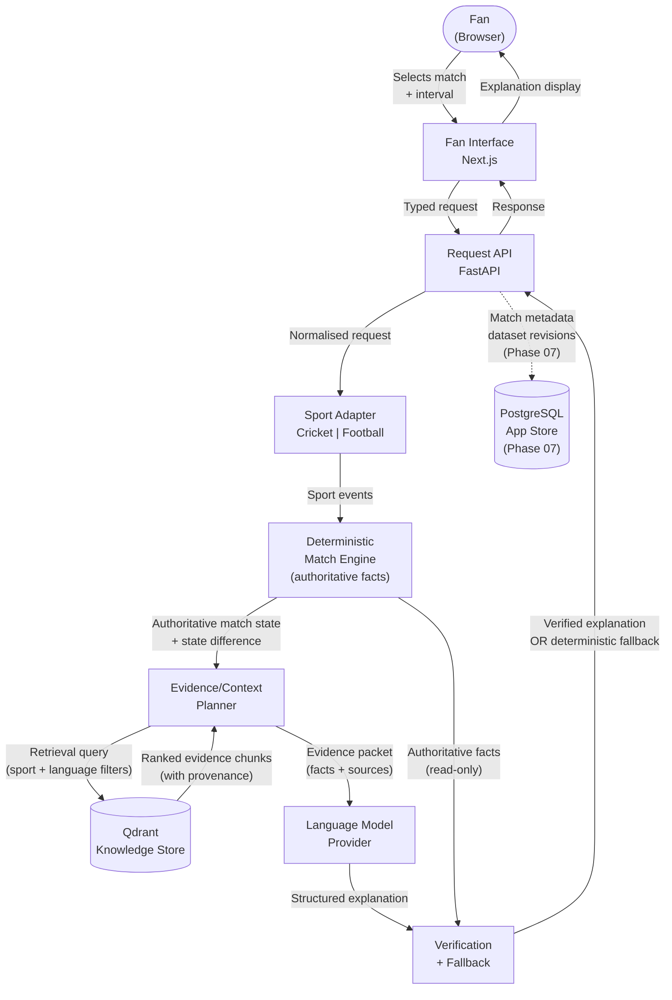

# FanCue — System Context

*Phase 00 architecture document. Describes proposed boundaries, not implemented services.*

---

## Logical Boundaries

**Deployment note:** This is the logical architecture when optional retrieval is configured. The current Render blueprint sets `FANCUE_RETRIEVAL_ENABLED=false`; the deployed historical catch-up path does not depend on Qdrant.

| Component | Responsibility | Implementation status |
|---|---|---|
| Fan interface | Next.js web UI — interval selector, explanation display, fallback display | Phase 06 |
| Request API | FastAPI — validates and routes fan requests | Phase 03 |
| Sport adapter | Cricket or football adapter — normalises events, applies sport-specific logic | Phase 03 (cricket), Phase 08 (football) |
| Deterministic match engine | Reconstructs match state from events; sole authoritative source of match facts | Phase 03 |
| Evidence/context planner | Assembles a typed evidence packet from engine facts plus optional retrieval results | Implemented; retrieval conditional |
| Qdrant knowledge retrieval | Optional semantic search over contextual knowledge; disabled in the current Render production configuration | Optional subsystem |
| Language model provider | Generates bounded explanation from evidence packet | Phase 05 |
| Verification | Checks LLM output against authoritative facts; triggers fallback on failure | Phase 05 |
| Deterministic fallback | Returns structured summary from engine+evidence when LLM unavailable or fails | Phase 05 |
| PostgreSQL | Durable store for match metadata, dataset revisions, evaluation records | Phase 07 |

---

## Authoritative Boundaries

- The **match engine** is the sole author of match facts (scores, events, state).
  No other component may write or mutate match state.
- **Qdrant** stores contextual knowledge only (rules, history, player context).
  It never stores authoritative match scores or live event data.
- The **LLM** produces explanatory prose bounded by the evidence packet.
  It cannot access the match engine directly.
- The **verification layer** has read-only access to both the engine output and
  the LLM output. It produces a pass/fail result — it does not rewrite either.

---

## System Context Diagram



---

## Data Flow — Fan Request

```
1. Fan specifies: match_id, interval_start, interval_end, language
2. API validates request shape (Pydantic schema)
3. Sport adapter selects correct event parser (cricket or football)
4. Match engine reconstructs state at interval_start and interval_end
5. Match engine calculates state difference (what changed)
6. Evidence planner builds the typed evidence packet from deterministic state delta, key events, and source provenance.
7. If retrieval is explicitly enabled and available, retrieve top-K contextual chunks with provenance metadata; otherwise continue with no retrieved chunks.
8. The evidence packet separates:
     - authoritative_state_diff (from engine)
     - optional retrieved_chunks (from Qdrant, with doc_id + source)
9. LLM receives evidence packet + prompt template; produces structured explanation
10. Verification checks:
     - All score claims match authoritative_state_diff
     - All cited doc_ids exist in evidence packet
     - No hallucinated statistics
11a. Verification passes -> return verified explanation
11b. Verification fails -> return deterministic fallback (engine + evidence, no LLM prose)
```

---

## What This Diagram Does Not Show

- Redis, background workers, and transactional outbox (conditional — see ADR-007).
- MCP operational tools (not on fan-facing path — see AGENTS.md section 12).
- Authentication and authorisation (planned but not yet designed).
- CDN or edge infrastructure (production concern, out of Phase 00 scope).
- Monitoring, alerting, and observability stack (Phase 07).
