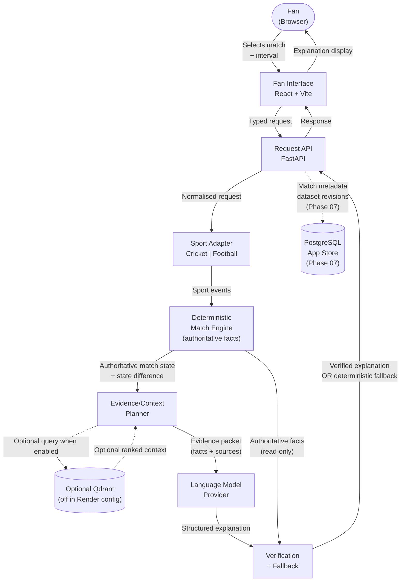

# FanCue — System Context

*Architecture baseline. Status reflects current code/configuration as of 2026-10-14; planned components are not implied to be enabled in production.*

---

## Logical Boundaries

| Component | Responsibility | Implementation status |
|---|---|---|
| Fan interface | React + TypeScript + Vite UI — interval selector, explanation display, fallback display | Implemented |
| Request API | FastAPI — validates and routes fan requests | Implemented |
| Sport adapter | Cricket normalization is on the request path; football is not claimed as a complete product path | Cricket implemented; football deferred |
| Deterministic match engine | Reconstructs match state from events; sole authoritative source of match facts | Implemented for supported cricket fixtures |
| Evidence/context planner | Assembles typed evidence from engine output plus optional retrieval results | Implemented; retrieval optional |
| Qdrant knowledge retrieval | Optional semantic search over contextual knowledge; not the match-fact source | Implemented for development/evaluation; disabled in current Render config |
| Language model provider | Configured Groq/OpenAI-compatible provider drafts explanation from evidence | Provider code present; actual live credentials/runtime not verified here |
| Verification | Checks LLM output against authoritative facts; triggers fallback on failure | Implemented |
| Deterministic fallback | Returns structured summary from engine facts when LLM is unavailable or fails verification | Implemented |
| PostgreSQL | Durable store for match metadata, dataset revisions, evaluation records | Phase 07 |

---

## Authoritative Boundaries

- The **match engine** is the sole author of match facts (scores, events, state).
  No other component may write or mutate match state.
- **Qdrant**, when enabled, stores contextual knowledge only (rules, history, player context). It never stores authoritative match scores or live event data. The checked-in `render.yaml` sets `FANCUE_RETRIEVAL_ENABLED=false`, so production retrieval is currently bypassed.
- The **LLM** produces explanatory prose bounded by the evidence packet.
  It cannot access the match engine directly.
- The **verification layer** has read-only access to both the engine output and
  the LLM output. It produces a pass/fail result — it does not rewrite either.

---

## System Context Diagram



---

## Data Flow — Fan Request

```
1. Fan specifies: match_id, interval_start, interval_end, language
2. API validates request shape (Pydantic schema)
3. Sport adapter selects correct event parser (cricket or football)
4. Match engine reconstructs state at interval_start and interval_end
5. Match engine calculates state difference (what changed)
6. Evidence planner assembles retrieval query from state difference events
7. If retrieval is enabled and reachable, Qdrant returns top-K contextual chunks with provenance; otherwise this step is skipped.
8. Evidence planner builds a typed packet containing authoritative state facts and provenance; optional retrieved chunks are included only when retrieval is enabled and succeeds.
9. LLM receives evidence packet + prompt template; produces structured explanation
10. Verification checks:
     - All score claims match authoritative_state_diff
     - All cited doc_ids exist in evidence packet
     - No hallucinated statistics
11a. Verification passes -> return verified explanation
11b. Verification fails -> return deterministic fallback (engine + evidence, no LLM prose)
```

---

## What This Diagram Does Not Show

- Redis, background workers, and transactional outbox (conditional — see ADR-007).
- MCP operational tools (not on fan-facing path — see AGENTS.md section 12).
- Authentication and authorisation (planned but not yet designed).
- CDN or edge infrastructure (production concern, out of Phase 00 scope).
- Monitoring, alerting, and observability stack (Phase 07).
